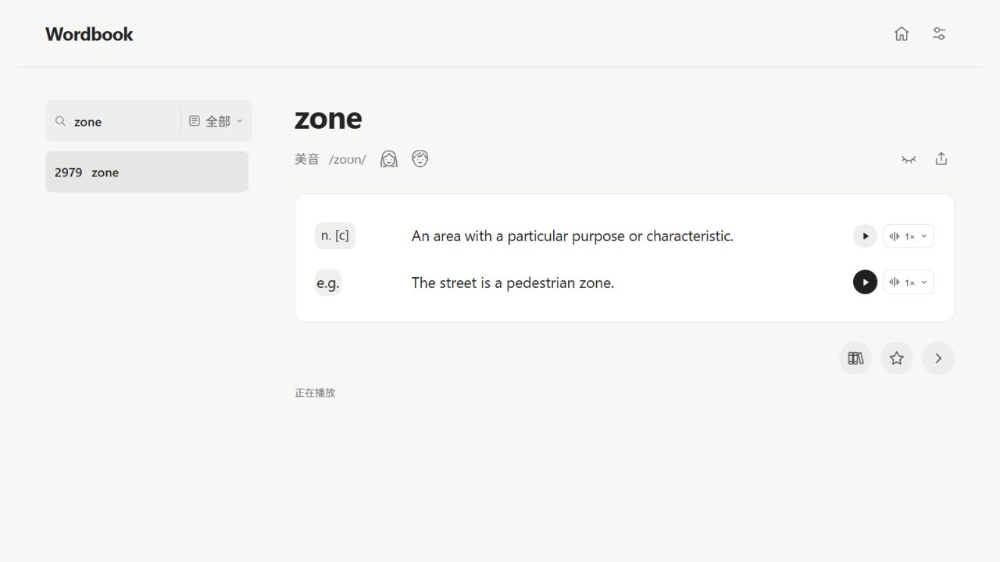

# Wordbook Desktop

[简体中文](#简体中文) · [English](#english)

## 简体中文

Wordbook 是一款 Windows x64 离线英语词汇学习软件。v0.1.0 内置基于美式 Oxford 3000 词表整理的 **2,979 个词条**，覆盖 CEFR A1–B2。

### 下载和运行

1. 在 GitHub 的 **Releases** 页面打开 **v0.1.0**，下载附件 **Wordbook-v0.1.0-Windows-x64.zip**。
2. 右键 ZIP，选择 **全部解压缩**。
3. 打开解压得到的 **Wordbook-win32-x64** 文件夹，双击 **Wordbook.exe**。请保留同目录的 `resources` 和其他配套文件。

这是免安装版。运行时无需联网，也无需安装 Node.js 或 Python。

### 功能

- 按 CEFR 等级、每次词数和学习顺序安排学习。用 **Continue** 学新词，用 **Review** 复习已学但未掌握的词。
- 支持英文和中文搜索、收藏和已掌握标记。中文释义和例句翻译默认隐藏，可随时显示。
- 词头提供男声和女声美式发音。英文释义和例句可分别播放并调速。
- 可导出当前词、单词本或全部词条。按需选择 TXT、JSON 和音频，合并导出为一个 ZIP。

### 界面预览

左侧支持中英文搜索。词头旁的两个人像按钮播放女声和男声。释义和例句各有播放和语速控制，可以慢速听，再跟读。右上角可以显示中文或导出材料，右下角可以收藏或标记已掌握。

打开词书后，可以先选等级、每次词数和学习顺序，再用 **Continue** 学新词或用 **Review** 复习。也可以点 **Browse All Words** 浏览整本词书。

### 音频是怎么做的

1. **整理录音稿。** 分开准备词头、英文释义和英文例句，需要另录的备用读音单独列出。
2. **生成录音。** 项目使用 ElevenLabs 和 Cartesia 生成美式英语音频，词头准备女声和男声，释义和例句各有独立录音。
3. **切分和对齐。** 将批量录音切成独立片段，按词条、义项和例句建立映射，让播放按钮找到对应的本地 MP3。
4. **质检和补录。** 检查缺失、错配及切片边界，对标记的问题复听，必要时重切或补录。音频随发布包提供，学习时可以离线播放。

### 学习记录与当前版本

学习记录保存在本机 `%APPDATA%\WordbookDesktop`，可通过软件的 **文件** 菜单手动备份。词包导入和学习记录恢复界面尚未开放。四种备用读音仍有八个男／女声音频绑定空位，全量人工听审尚未完成。

### 本地开发

仓库包含 Electron 源码、学习界面、构建脚本和测试。完整词库、音频和预生成的 `word-data.js` 随 Windows ZIP 提供。

1. 安装 Node.js 24，进入仓库里的 `wordbook-desktop-github/` 目录后运行 `npm ci` 和 `npm test`。
2. 解压 Windows ZIP，找到其中的 `Wordbook-win32-x64\resources\library`。在修改界面前，用 `node scripts/prepare-library.cjs "完整的 library 路径"` 补齐本地资源并生成清单。该命令会复制界面文件到仓库的 `library/`，已有修改请先保存。
3. 运行 `npm start`。如需构建 Windows 免安装版，先运行 `node scripts/download-runtime.cjs` 下载并校验 Electron 运行时，再运行 `npm run package`。产物位于 `release-v0.1.0/Wordbook-win32-x64/`。

## English

Wordbook is an offline English vocabulary app for Windows x64. Version 0.1.0 includes **2,979 entries** based on the American Oxford 3000 list, covering CEFR levels A1–B2.

### Download and run

1. Open **v0.1.0** on the repository’s **Releases** page and download **Wordbook-v0.1.0-Windows-x64.zip** under **Assets**.
2. Right-click the ZIP and select **Extract All**.
3. Open the extracted **Wordbook-win32-x64** folder and double-click **Wordbook.exe**. Keep the `resources` folder and the accompanying files alongside it.

The app is portable and runs offline. Node.js and Python are unnecessary for regular use.

### Features

- Set a CEFR level, session size, and study order. Use **Continue** for new words and **Review** for words you have studied but have yet to master.
- Search in English or Chinese, save words to your wordbook, and mark them as mastered. Chinese definitions and example translations are hidden by default and can be revealed as needed.
- Listen to male and female American English headword recordings. Play definitions and examples separately and adjust their playback speed.
- Export the current word, saved words, or the full list. Choose TXT, JSON, and audio as needed and download them together in one ZIP.

### Interface preview

Use the sidebar to search in English or Chinese. The two buttons beside the headword play female and male recordings. Definitions and examples have separate playback and speed controls for slow listening and shadowing. The upper-right controls reveal Chinese or export materials. The lower-right controls let you save a word or mark it as mastered.

Open the book to choose a level, session size, and study order. Select **Continue** for new words, **Review** for practice, or **Browse All Words** to explore the full list.

### How the audio was made

1. **Prepare scripts.** Headwords, definitions, and examples were organized into separate scripts. Alternate pronunciations that needed their own recordings were listed separately.
2. **Generate recordings.** The project used ElevenLabs and Cartesia to generate American English audio, with female and male headword recordings and separate clips for definitions and examples.
3. **Split and align.** Batch recordings were cut into clips and mapped to word entries, senses, and examples so each player could load its corresponding local MP3.
4. **Check and retake.** Checks covered missing clips, mismatches, and cut boundaries. Flagged clips were reviewed and recut or regenerated as needed. Audio ships with the app for offline playback.

### Study data and current limitations

Study data is stored locally in `%APPDATA%\WordbookDesktop`. You can back it up manually from the **File** menu. Word-pack import and a study-data restore interface are planned features. Four alternate pronunciations still have eight empty male/female audio bindings. A full manual listening review is pending.

### Local development

The repository contains the Electron source, study interface, build scripts, and tests. The Windows ZIP supplies the full word data, recordings, and generated `word-data.js`.

1. Install Node.js 24. Run `npm ci` and `npm test` in the `wordbook-desktop-github/` directory.
2. Extract the Windows ZIP and locate `Wordbook-win32-x64\resources\library`. Before editing the interface, run `node scripts/prepare-library.cjs "absolute path to library"` to populate the local assets and generate their manifest. This command copies interface files into the repository’s `library/`, so save any existing changes first.
3. Run `npm start`. To build the portable Windows app, run `node scripts/download-runtime.cjs` to download and verify the Electron runtime, then run `npm run package`. Find the output under `release-v0.1.0/Wordbook-win32-x64/`.

